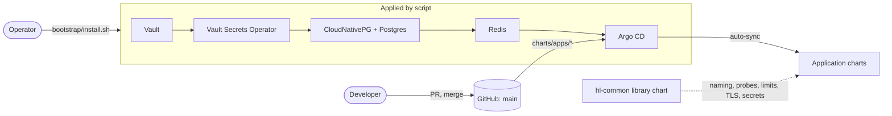
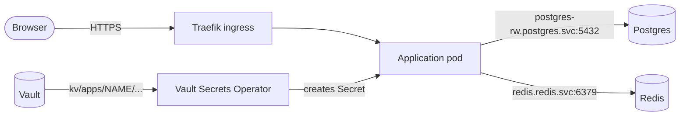

# hl-helm

Helm charts that define and maintain a single-node k3s homelab. The repository is the source of
truth: the cluster can be rebuilt from an empty node with `bootstrap/install.sh`.

## Tier model

| Tier | Directory | Applied by | Members |
|------|-----------|-----------|---------|
| Library | `charts/library/` | consumed by other charts | `hl-common` |
| Bootstrap | `charts/bootstrap/` | `bootstrap/install.sh` | Vault, Argo CD |
| Infrastructure | `charts/infrastructure/` | `bootstrap/install.sh` | Vault Secrets Operator, CloudNativePG, Postgres, Redis |
| Application | `charts/apps/` | Argo CD, auto-sync from `main` | one chart per application; `nginx` is the reference |

## How it fits together

**How changes reach the cluster.** Two paths, one per kind of tier. The operator runs
`bootstrap/install.sh`, which installs the foundation in the order shown; Argo CD then deploys the
applications from `main`.

**How a running application is wired.** An application chart only names what it needs. Secrets
come from Vault, never from Git, and traffic enters through Traefik.

In short:

- **Tiers depend downwards only.** Bootstrap needs nothing in the cluster, infrastructure may use
  bootstrap, applications may use both ([`docs/tiers.md`](docs/tiers.md)).
- **Argo CD manages applications only.** A merge can never restart a database; infrastructure
  changes only when an operator runs the script.
- **Every chart is thin.** Applications depend on `hl-common` and nothing else; Postgres and Redis
  are reached by address, not embedded.
- **Secrets live in Vault.** Charts carry Vault paths only; VSO turns them into Kubernetes Secrets
  and keeps them current.
- **One application, one chart, one namespace**, named for its directory.

Start with [`docs/onboarding.md`](docs/onboarding.md) to deploy an application,
[`docs/bootstrap.md`](docs/bootstrap.md) to rebuild the cluster, [`docs/access.md`](docs/access.md) to reach `kubectl`, Vault, Argo CD, Postgres and Redis from your workstation, [`docs/remote-access.md`](docs/remote-access.md) for app addresses, the shared certificate and Tailscale, and [`docs/tiers.md`](docs/tiers.md)
for what each tier may depend on. Measured results are in
[`docs/validation-results.md`](docs/validation-results.md).

See `specs/001-extensible-helm-charts/` for the specification, plan and tasks, and
`.specify/memory/constitution.md` for governance.

## Cluster baseline

- k3s version: v1.36.5+k3s1 (Kubernetes 1.36, single control-plane node, Ubuntu 26.04 LTS, containerd 2.3.4) — recorded 2026-10-18
- Storage classes: `local-path` (default, `rancher.io/local-path`, reclaim policy Delete, WaitForFirstConsumer)
- Ingress: Traefik (k3s built-in), running in `kube-system` with svclb

## Validation

`scripts/validate.sh` runs the pre-merge gate (lint, template, unit tests, schema validation).
