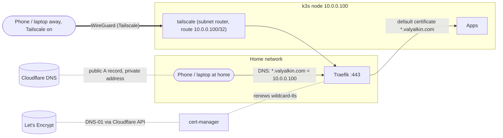

# Home and remote access

Homelab apps live at `https://<name>.valyalkin.com`. The same address works on any device at
home and, through Tailscale, on the owner's devices anywhere. Nothing is open to the internet.
Background: hl-budget-spec feature 005.



| Piece | Where | What it does |
|---|---|---|
| `*.valyalkin.com A 10.0.0.100` (DNS only) | Cloudflare, set by hand | Every app name resolves to the node, for any device |
| `cert-manager` + `ingress-tls` | `charts/infrastructure/` | One Let's Encrypt certificate for `valyalkin.com` and `*.valyalkin.com`, Traefik's default; HTTP redirects to HTTPS |
| `tailscale` | `charts/infrastructure/` | Subnet router: tailnet devices get a route to `10.0.0.100` only |
| Tailnet policy | Tailscale admin console | Who may use the route, and only on ports 80 and 443 |

## Using it

- **At home**: open `https://<app>.valyalkin.com`. Nothing to install.
- **Away**: turn Tailscale on (phone or laptop, signed in as the owner), then open the same
  address. On Linux, run `tailscale set --accept-routes` once. macOS, Windows, iOS and Android
  use subnet routes by default.
- **A new app**: give its Ingress a host `<app>.valyalkin.com` and leave `tls.secretName` unset
  (`docs/onboarding.md`). The wildcard DNS record and certificate already cover it.

## The tailnet policy

Kept in the Tailscale admin console (*Access controls*). Its source of truth is
hl-budget-spec `specs/005-home-and-remote-access/contracts/tailnet-policy.md`:

```jsonc
{
  "tagOwners":     { "tag:homelab": ["autogroup:admin"] },
  "autoApprovers": { "routes": { "10.0.0.100/32": ["tag:homelab"] } },
  "grants": [
    { "src": ["autogroup:member"], "dst": ["10.0.0.100/32"], "ip": ["tcp:80", "tcp:443"] },
  ],
  "tests": [
    { "src": "valyalkin@gmail.com", "accept": ["10.0.0.100:443", "10.0.0.100:80"], "deny": ["10.0.0.100:22", "10.0.0.100:6443"] },
  ],
}
```

- **What VPN devices can reach**: only `10.0.0.100:80` and `10.0.0.100:443`. No SSH, no
  Kubernetes API, and no other home device. `kubectl` still uses the SSH tunnel
  (`docs/access.md`).
- **The gateway** (`tag:homelab`) can't start connections to the owner's devices.

## Devices

- **Add**: install Tailscale and sign in with the owner's account. It appears under *Machines*.
- **Remove** (lost or stolen): *Machines* → the device → *Remove*. Its access ends immediately.
  HL Budget still requires an Auth0 sign-in either way.
- **Key expiry**: personal devices re-authenticate every 180 days (the default). The gateway is
  tagged, so it never expires.

## The gateway's credential

An OAuth client in the Tailscale admin console (*Settings → OAuth clients* / *Trust
credentials*): description "homelab gateway", scope *Auth Keys: Write*, tag `tag:homelab`. The
secret is in Vault `kv/infra/tailscale`, key `client_secret`.

- **Rotate**: generate a new client secret, write it to Vault, then revoke the old one. VSO syncs
  it within an hour and restarts the gateway. The gateway keeps its identity
  (`Secret/tailscale-state`), so nothing else changes.
- **Re-register from scratch**: delete `Secret/tailscale-state` in namespace `tailscale` and the
  `homelab` machine in the admin console, then restart the pod.

## Troubleshooting

| Symptom | Check |
|---|---|
| Works at home, not away | `scripts/infra-status.sh`: *Tailscale gateway* online with route `10.0.0.100/32`. In the admin console the route is approved, and the device has Tailscale on |
| Away works, home doesn't, on one device | The home router may refuse DNS answers that point at a private address ("DNS rebind protection"). Compare `dig +short budget.valyalkin.com` with `dig +short budget.valyalkin.com @1.1.1.1`. Fix: add a rebind exception for `valyalkin.com` in the router, or keep Tailscale on at home on that device |
| Certificate warning | `scripts/infra-status.sh`: *Certificates*, `wildcard READY True`, days left. Check that the app's Ingress has no `tls.secretName` of its own |
| `http://` doesn't redirect | `kubectl -n kube-system get helmchartconfig traefik` (owned by `ingress-tls`) |

See also [`access.md`](access.md), [`onboarding.md`](onboarding.md) and [`bootstrap.md`](bootstrap.md).
